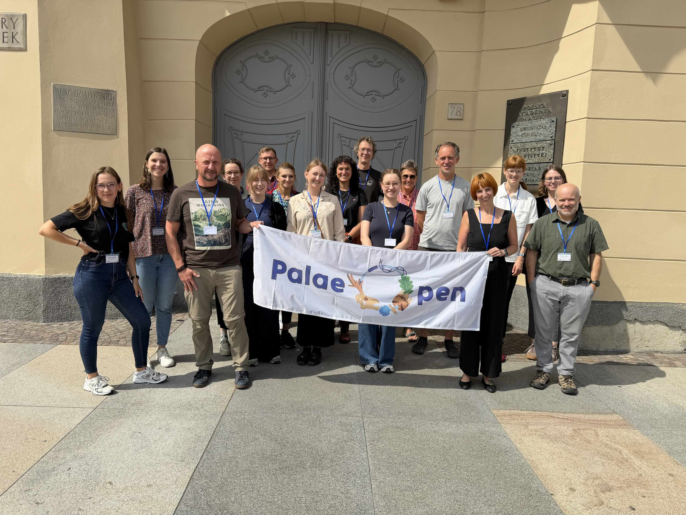
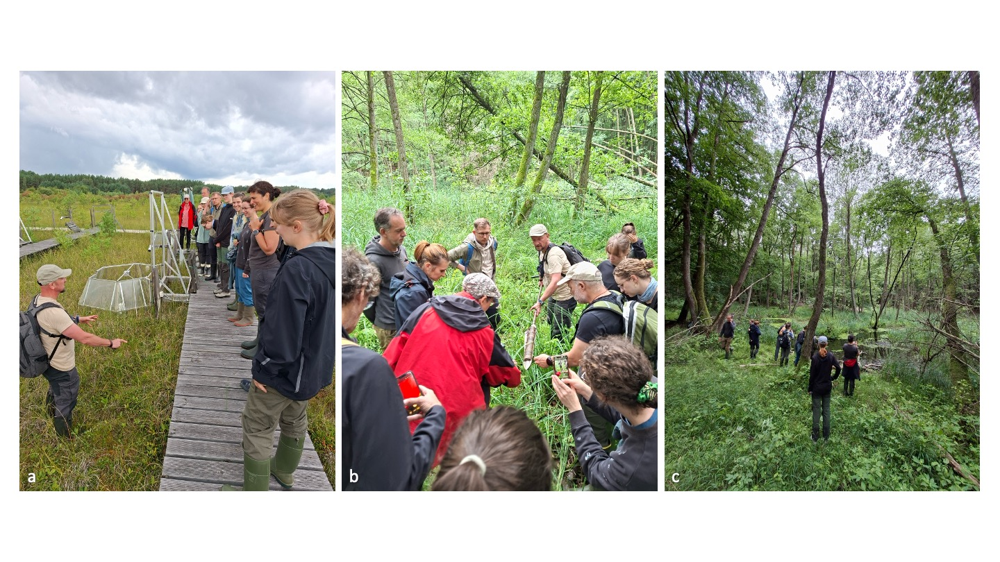

# Tiny Microbes with Superpowers! Neotoma Workshop on Testate Amoebae {text-align="center"}

::: {.callout-note}
## 📅 Event details

**Dates:** 17-19 August 2026  
**Location:** Poznań, Poland 
**Organizers:** prof. Mariusz Lamentowicz, dr Monika Karpińska-Kołaczek, dr Mariusz Bąk, and MSc Daria Wochal (Adam Mickiewicz University, Poznań, Poland)
:::

## Introduction

Testate amoebae are unicellular organisms commonly found in peatlands and are among the most important proxies for peatland palaeoecological research. They enable the reconstruction of past hydrological changes in peatlands, giving crucial insights into peatland ecology, disturbance history, and health status. They are studied in various peatland types across the world, and over the last 25 years, huge advances have been made in the use of testate amoebae in palaeoecological records. Yet testate amoeba datasets remain scarce in the Neotoma Paleoecology Database (“Neotoma”), particularly from Europe. In fact, the majority of testate amoeba records in Neotoma come from North America and, until now, only one Data Steward was taking care of testate amoeba data – Prof. Robert Booth (Lehigh University, USA). That is why a workshop aiming to train new data stewards from Europe was organized within the PalaeOpen COST Action.

## Themes discussed

The workshop gathered 17 participants from 8 countries (Figure 1), and included thematic sessions, breakout group activities, general discussions, Neotoma data steward training, and a field trip. After a warm welcome from the organizers, the meeting started with a thematic session on Conceptual foundations and testate amoeba data that included invited presentations. Dr. Petr Kuneš (Charles University in Prague, Czechia) presented the Neotoma and PalaeOpen initiatives, Prof. Robert Booth presented the state of testate amoebae datasets, and Prof. Edward Mitchell (University of Neuchâtel, Switzerland) focused on testate amoeba taxonomy and database challenges. This was followed by a breakout group discussion on challenges related to testate amoeba data compilation and metadata. The day ended by synthesizing the information and planning a publication of a synthesis report.
The second day of the workshop focused solely on practical training in data input into the Neotoma database and data workflow in Neotoma, led by Dr. Petr Kuneš and Prof. Robert Booth.
The workshop ended with a field trip to several peatlands located close to Poznań, where discussions on testate amoebae continued (Figure 2). Participants learned about the history of human impact on peatlands in the Noteć Forest (presented by Prof. Katarzyna Marcisz and Dr. Mariusz Bąk) and Zielonka Forest (presented by Prof. Mariusz Lamentowicz and MSc Daria Wochal), and visited the Rzecin experimental site (led by Prof. Mariusz Lamentowicz). They also discussed protocols for sampling testate amoeba surface samples from Sphagnum-dominated peatlands (led by Prof. Edward Mitchell).

:::{#fig-1}

Group photo in front of the workshop venue – Pałac Działyńskich, Polish Academy of Sciences, Poznań (photo: Piotr Kołaczek).

:::

:::{#fig-2}

Workshop participants in the field: (a) visiting the Rzecin peatland and experimental site in the Noteć Forest, (b) examining peat and (c) admiring wetlands in the Zielonka Forest (photos: Katarzyna Marcisz).

:::

## The outcome of group discussions

During the discussion, several problems related to testate amoeba data availability and assessment have been raised. The key messages are:
- the lack of data stewards led to a lack of interest in using and contributing testate amoeba data to Neotoma;
- the lack of interest is an effect of no tradition of inputting data to Neotoma and no encouragement from journals and the community to do so;
- the community should upload datasets to Neotoma and promote testate amoeba research outside the testate amoeba community.

Key takeaways and future directions
- The testate amoeba community is motivated and excited to open up their data to the public via Neotoma.
- Several researchers are happy to take on the role of data stewards and to promote the COST Action activities.
- Organizers are planning to publish a synthesis report to which all participants will contribute. The paper will catalogue testate amoeba methods, key protocols and literature necessary for the community to produce comparable data.

## Key Takeaways

- Many chironomid datasets are currently inaccessible and at risk of being lost
- Standardisation is essential to enable comparison and reuse across studies
- Open-access platforms like Neotoma play a key role in long-term data preservation
- Transparent authorship and collaboration framework encourage data sharing

## Postscriptum. Additional activities

The workshop in Poznań was followed by an online course on October 15th, led by Dr. Petr Kuneš and Prof. Robert Booth. The community discussed more issues related to data input into Neotoma. Since the meeting, the testate amoeba community already has a first new Testate Amoeba Data Steward on board – congratulations to Mariusz Lamentowicz – and a few more in training.

## What’s next
Following the workshop and an online meeting, the testate amoeba community is determined to make testate amoeba data open and available to the scientific community. Work on the datasets is ongoing, and plans are being made to expand the current extent of the testate amoeba database to European sites. Additional meetings will be necessary to maintain momentum and promote these activities. The upcoming 12th International Symposium on Testate Aamoebae (ISTA-12 2027 in Neuchâtel, Switzerland, https://testate-amoebae-society.org/meetings/) will be a good forum for a call to action. 
