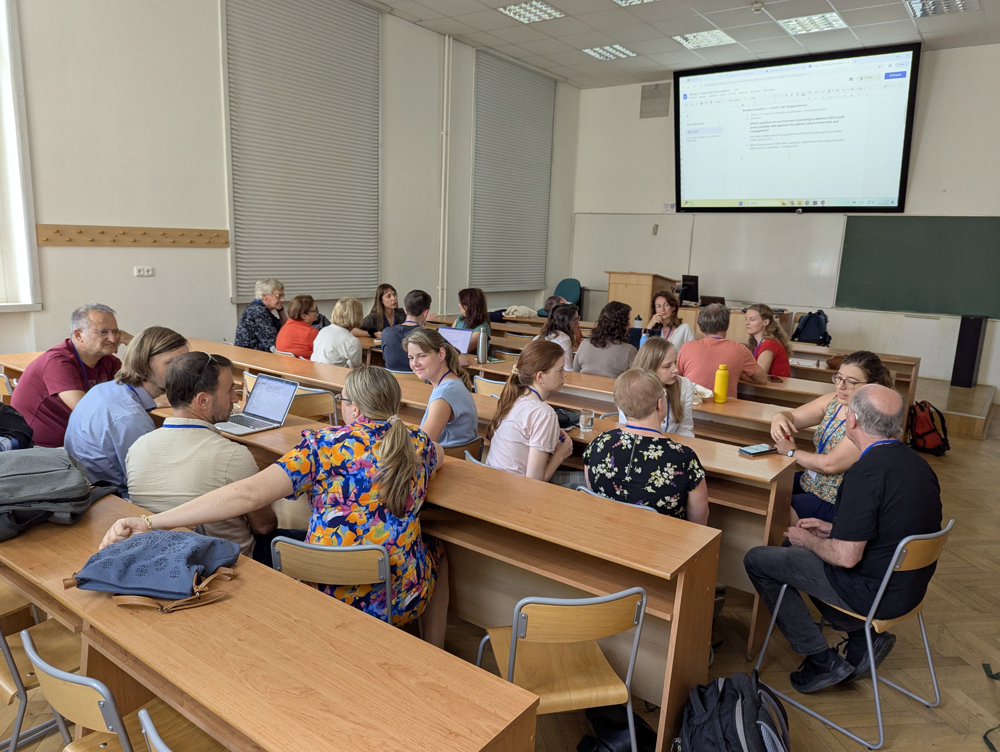
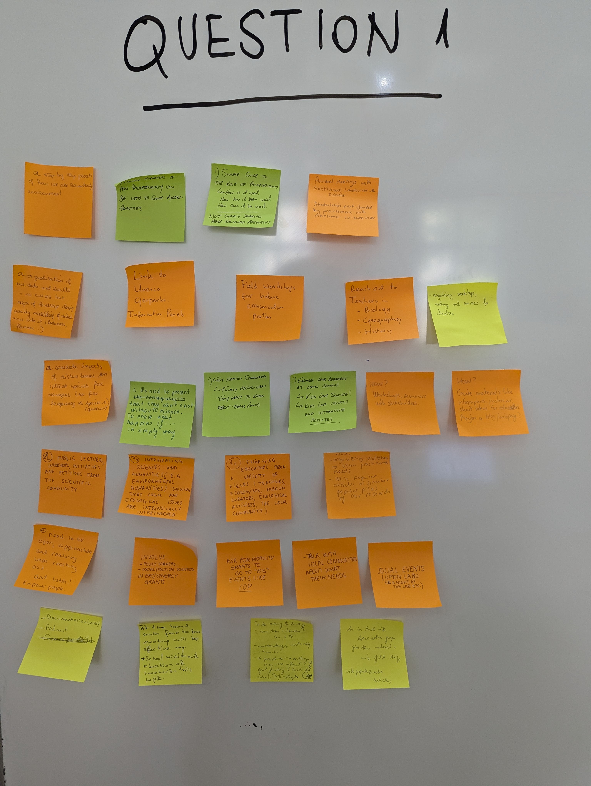
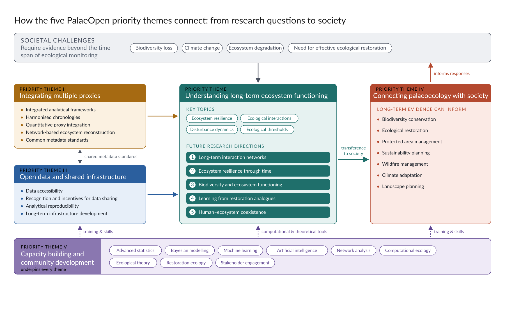

# Developing a transdisciplinary research agenda for the future of European palaeoecology 

European palaeoecology is undergoing a period of rapid transformation. Advances in palaeoenvironmental proxies, analytical methods, computational approaches, and data infrastructures are expanding our capacity to investigate long-term ecosystem dynamics at unprecedented temporal and spatial scales. At the same time, society faces major environmental challenges, including biodiversity loss, climate change, ecosystem degradation, and the need for effective ecological restoration. 

These challenges require scientific evidence that extends beyond the temporal limits of ecological monitoring and historical observations. Palaeoecology is uniquely positioned to provide such evidence by documenting ecosystem responses to environmental change over decades, centuries, and millennia.

Recognising both the opportunities and challenges facing the discipline, members of the PalaeOpen community undertook a structured consultation exercise to identify priorities for the future development of European palaeoecology. Through facilitated discussions involving researchers from diverse disciplinary backgrounds (@fig-consultation), participants identified key scientific challenges, methodological needs, societal opportunities, and community-development priorities. 

:::: {#fig-consultation layout="[[64,36]]" layout-valign="top"}

{fig-alt="Meeting attendees seated at desks in a lecture room, turned towards each other in discussion, with a shared document projected on a screen."}

{fig-alt="Whiteboard headed 'Question 1' covered with handwritten sticky notes from attendees."}

Community consultation on the research agenda.

::::

**A shared vision for European palaeoecology**: The consultation revealed broad agreement that palaeoecology should increasingly contribute to understanding ecosystem functioning and informing contemporary environmental challenges (@fig-flowchart):

- *Priority theme I – Understanding long-term ecosystem functioning.* Key topics include ecosystem resilience, ecological interactions, disturbance dynamics and ecological thresholds. 

- *Priority theme II – Integrating multiple proxies.* Future developments should focus on integrated analytical frameworks, common metadata standards, harmonised chronologies, quantitative proxy integration, and network-based approaches to ecosystem reconstruction.
 
- *Priority theme III – Open data and shared infrastructure.* Priorities include data accessibility, recognition and incentives for data sharing, analytical reproducibility and long-term infrastructure development.

- *Priority theme IV – Connecting palaeoecology with society.* Palaeoecology can inform biodiversity conservation, ecological restoration, protected area management, sustainability planning, wildfire management, climate adaptation and landscape planning. 

- *Priority theme V – Capacity building and community development.* Training priorities include advanced statistics, Bayesian modelling, machine learning, artificial intelligence, network analysis, computational ecology, ecological theory, restoration ecology and stakeholder engagement. 
 
::: {#fig-flowchart}

{fig-alt="Flow chart of the five PalaeOpen priority themes. Societal challenges (biodiversity loss, climate change, ecosystem degradation, need for effective restoration) feed into Theme I, understanding long-term ecosystem functioning, with its key topics and five future research directions. Theme II (integrating multiple proxies) and Theme III (open data and shared infrastructure) feed into Theme I. Theme I transfers to Theme IV (connecting palaeoecology with society), which informs responses to the societal challenges. Theme V (capacity building and community development) underpins every theme through training, skills and computational and theoretical tools."}

Flow chart connecting the research questions, priorities and transference to society of PalaeOpen

:::

**The new generation of palaeoecological science** should focus on interactions rather than isolated taxa, functions rather than species counts, mechanisms rather than descriptions, resilience rather than static baselines, and trajectories rather than snapshots. Therefore the future directions of the discipline in Europe should address: 

- Long-term interaction networks, 
- Ecosystem resilience through time,
- Biodiversity and ecosystem functioning,
- Learning from restoration analogues,
- Human-ecosystem coexistence. 

This community consultation represents the first stage of developing a comprehensive European research agenda for palaeoecology and should be considered as a living framework because the discipline possesses both complementary and unique long-term evidence capable of addressing some of the most pressing environmental challenges facing society. 
